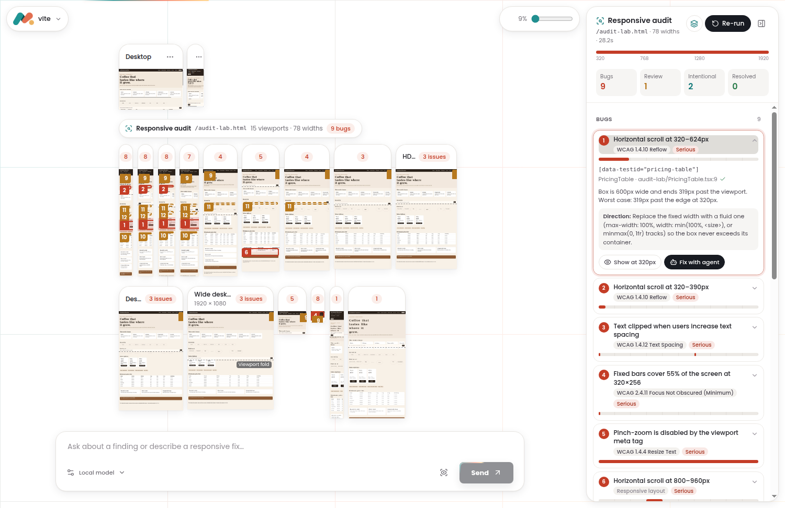

# Mauxi

A local-first **Linux** desktop workspace that audits how a real web app behaves at every viewport width and zoom level, and fixes what breaks in the project's own source.

Open a local project, run the **responsive audit**, and Mauxi sweeps the page from 320 to 1920 px plus phone, tablet, laptop, desktop, 400% zoom and text-spacing profiles. It reports horizontal overflow, content cut off, clipped text, small touch targets, sticky bars that cover the screen and zoom-blocking viewport tags, mapped to the WCAG 2.2 criteria that depend on the viewport. It also runs [axe-core](https://github.com/dequelabs/axe-core) contrast, name, label, ARIA and landmark rules at every width profile, so problems that exist only in the mobile (or only in the desktop) layout are reported with the widths where they occur. It tells deliberate carousels, tables and code blocks apart from accidental scrolling. Each finding comes with the widths where it happens, the element and its source file, and a fix direction you can hand to the agent.



## What it does

- Audits the route in the Desktop preview across a width sweep and full-check profiles without touching the visible previews, with snapshots of every profile on the canvas. See [responsive audit](docs/audit.md).
- Adds a bounded interaction pass at narrow widths: a Tab-only keyboard focus walk, closed menus opened one at a time, and tooltips hovered.
- **Audit site** finds the pages linked from the current route (at most 12, skipping authentication, API, action and download links) and audits the ones you check in a batch, with an **All pages** summary.
- Classifies findings as bugs, needs review or intentional patterns with accessibility gaps; resolved findings are tracked between runs.
- **Show at &lt;width&gt;** resizes a live preview to the failing width and outlines the element; **Fix with agent** attaches the finding to chat, and the agent verifies its fix with the same audit.
- Opens React + Vite and supported Next.js projects (Webpack or Turbopack dev server) with an explicit launch plan and temporary preview integration.
- Keeps desktop and mobile previews live while you pan, zoom, focus, resize, and select elements linked to their source.
- Offers resumable agent conversations and provider/model setup, with a host policy focused on responsive accessibility fixes.
- Applies live edits with retained checkpoints, conflict-aware recovery, and one-time command approval.
- Lets the agent inspect the same visible previews after an explicit handoff from chat, with separate approvals for interactions and checks retained in session history.

Mauxi is **early software**: the 0.1.0 AppImage has not yet passed its [acceptance gate](docs/acceptance.md), and it is not a general-purpose browser or OS sandbox. Opening a project runs its dev server with your user's privileges, so use trusted projects and development accounts. Only Linux is supported; macOS and Windows are outside this repository's scope.

## Run locally

Use Node.js 22 and npm on Linux, with a graphical desktop:

```bash
npm ci
npm run dev
```

Open a project with its dependencies already installed, review the proposed setup, and choose **Confirm & start**. Mauxi starts its own server without taking over one already running. Configure a provider and model through **Models & providers** in chat; a separate agent CLI is not required.

## Build an AppImage

```bash
npm run dist:linux
```

The artifact is written to `release/`. If FUSE is unavailable, launch the AppImage with `APPIMAGE_EXTRACT_AND_RUN=1`.

## Documentation

- [Responsive audit: checks, classification, limits](docs/audit.md)
- [Workspace, project setup, and preview controls](docs/workspace.md)
- [Agent conversations and responsive accessibility guidance](docs/agent.md)
- [Changes, command approval, undo, and recovery](docs/changes-and-recovery.md)
- [Setup, privacy, limits, and recovery](docs/usage.md)
- [AC-01–AC-25 acceptance gate and blockers](docs/acceptance.md)
- [Development and automated checks](docs/development.md)

The application uses one simple layered architecture: **presentation → application → infrastructure**. Automated tests and their fixtures stay in the repository; generated screenshots, logs, traces, and reports do not.

## Contributing and security

See [CONTRIBUTING.md](CONTRIBUTING.md). Report vulnerabilities privately as described in [SECURITY.md](SECURITY.md), not in public issues.

## License

Mauxi is released under the [MIT License](LICENSE).

Third-party code keeps its own license:

- [axe-core](https://github.com/dequelabs/axe-core) is © Deque Systems, Inc. and bundled unmodified under the [Mozilla Public License 2.0](https://www.mozilla.org/en-US/MPL/2.0/).
- The [anti-slop](https://github.com/dmmulroy/anti-slop) Oxlint plugin in `tools/oxlint/anti-slop/` is © Dillon Mulroy under the [MIT License](tools/oxlint/anti-slop/LICENSE).
- Its vendored `padding-line-between-statements` rule from [ESLint Stylistic](https://github.com/eslint-stylistic/eslint-stylistic) is under the [MIT License](tools/oxlint/anti-slop/vendor/eslint-stylistic/LICENSE).
