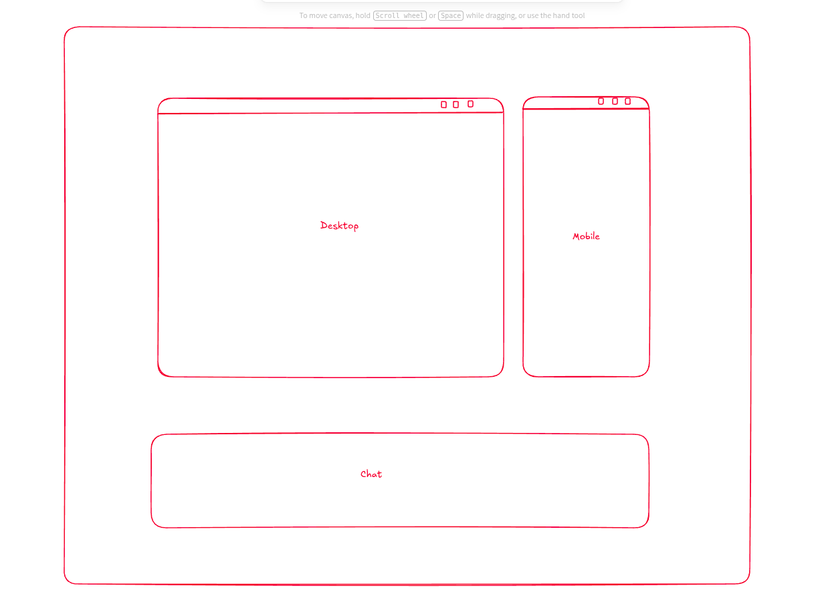

# Mauxi — private alpha specification

**Status:** Original private-alpha requirements and planning reference, not a current implementation report. Historical milestones, open decisions, and validation statements below describe the planning stage. See [README.md](README.md) and the linked product guides for current behavior and limitations.

**Product:** A local-first desktop workspace for polishing, building, and animating real web interfaces with a pi-powered coding agent.

**Initial audience:** Matias and a small group of frontend/design engineers.

**Platform:** Linux only. The macOS and Windows products will use different stacks and repositories. They are outside this specification; this codebase has no portability, shared-runtime, or cross-platform UI obligations.

## 1. Purpose and reading guide

Mauxi brings the running interface, precise element selection, design-engineering expertise, and an agent conversation into one workspace. Users work on their existing local source code, not a separate design document that must later be exported.

The core loop is:

> Open a project → confirm its development setup → inspect desktop and mobile → select exactly what matters → discuss a change → see live code edits → verify → review or undo.

The differentiator is not merely placing a chat beside a browser. It is the quality of the connection between **visual intent, the selected elements, their source code, and the running result**.

### Authority of this draft

- **Agreed decisions** in section 2 come from the planning interview.
- The remaining sections translate those decisions into **proposed implementation requirements and defaults**. They become the implementation baseline after review; they are not a claim that every detail was explicitly agreed in the interview.
- **Open decisions** are listed in section 13. Do not silently resolve them by weakening a core requirement.
- Requirement IDs are stable references for the later issue breakdown. Milestones are a proposed sequence, not already-created issues or delivery estimates.
- `Must` describes required behavior under this draft; `should` describes a preferred implementation; `deferred` means it does not block this alpha.

## 2. Agreed decisions

| ID | Decision |
| --- | --- |
| D-01 | Build a standalone desktop app powered by pi's SDK, not a fork of pi's core. |
| D-02 | Begin with a private alpha for the founder and a few design engineers. |
| D-03 | This repository implements the Linux product only. macOS and Windows use separate stacks and repositories, not later ports of this codebase. |
| D-04 | Changes are chat-driven edits to real project files, not a visual properties editor or drag-and-drop authoring system. |
| D-05 | The workspace is a freely pannable and zoomable canvas, not a fixed split-pane layout. |
| D-06 | The alpha has two live previews of the same implementation: desktop and mobile, with configurable viewport sizes. These are not competing design branches. |
| D-07 | Chat is anchored to the application window, below the canvas, rather than moving with the canvas. |
| D-08 | Each preview has element-selection, focus, and actions controls. |
| D-09 | Initial project support includes React + Vite and Next.js. |
| D-10 | Precise element selection is critical. Loose visual context is not an acceptable replacement for a reliable picker and useful source linkage. |
| D-11 | A request can include multiple selected elements, including selections from both previews. |
| D-12 | Development-only project instrumentation is allowed and must be removed when the app closes. |
| D-13 | The agent can operate the same visible previews to verify changes, with an explicit control handoff and take-back/stop affordances. |
| D-14 | Design and animation judgment comes from curated agent skills. Dedicated animation playback controls were not established as an alpha requirement. |
| D-15 | Mauxi owns a curated pi configuration and supports deliberate imports, rather than automatically inheriting a user's entire terminal configuration. |
| D-16 | Agent changes apply live in the open working directory, with checkpoints and changed-files review/undo. |
| D-17 | Inspect the project, propose its dev setup for confirmation, and then manage the dev server. Do not silently install dependencies or start additional services. |
| D-18 | Preview URLs are linked by default; scrolling and other interactions are independent. Navigation can be unlinked temporarily. |
| D-19 | Bundle pi's SDK and use its provider, authentication, and model capabilities. A separate pi CLI installation is not required. |
| D-20 | Project edits can run automatically after trust; arbitrary commands and dependency installation require approval. Saved dev/test commands can be pre-approved. |
| D-21 | Use a simple layered architecture in one Linux application: presentation, application, and infrastructure. Do not build speculative frameworks or abstractions for other platforms. |
| D-22 | Use `/apple-design` to guide Mauxi's visual interface and interaction design. Keep the interface minimal, clear, and focused on the previews and conversation. |

### Concept reference



This is a composition reference. Use `/apple-design` for the visual and interaction direction, within the minimal canvas-plus-bottom-chat layout. The freeform canvas, precise multi-selection, and explicit agent-control states remain core requirements.

## 3. Alpha scope and boundaries

### In scope

- Open and reopen an existing local project.
- Confirm project trust, framework integration, start command, and preview origin.
- Start/stop/restart an owned dev server; explicitly attach to an existing server.
- Two interactive, live responsive artboards on a freeform canvas.
- Precise visual picking, parent/child navigation, source context, and multi-selection attachments.
- Pi-backed streaming conversation, model/auth controls, tool activity, stop, steering, follow-up, and session resumption.
- Curated design/animation skills and tested preview tools.
- Live source edits, review, conflict-aware undo, and recoverable temporary instrumentation.
- Visible agent browser verification with control ownership.
- Linux packaging and a small, explicit compatibility matrix.

### Deferred or outside this alpha

- macOS/Windows implementations, portability layers, shared cross-platform packages, or coordination with those separate products. These are outside this repository, not a later phase of this plan.
- Pi core fork or a replacement provider/agent framework.
- Visual CSS/property editing, drag-and-drop page construction, or an animation timeline/keyframe editor.
- Dedicated animation pause/scrub/slow-motion controls; skill-guided code changes are sufficient for the current scope.
- More than two artboards, independent code variants, or design-branch comparison.
- Project-generation wizards, full environment provisioning, and automatic backend/database setup. The agent can still build new UI inside an open project.
- Figma import/export, a component marketplace, public plugin discovery, collaboration, cloud sync, hosted projects, or deployment.
- Native mobile simulation, Safari/device equivalence, or a full responsive device lab. The mobile artboard is a Chromium viewport at mobile dimensions.
- An embedded full IDE or terminal emulator. Source locations, diffs, and command logs are enough initially.
- Universal compatibility with every React/framework/bundler version or arbitrary remote websites.
- Unattended operation on untrusted repositories or an OS-level sandbox.
- Product accounts, subscription billing, or a proprietary model-access service.

**Proposed simplification:** one open project and one active agent execution at a time. A project can have several saved conversations, but parallel agents and simultaneous project workspaces are deferred.

**Implementation discipline:** one application, ordinary TypeScript modules, direct function calls within the host, and only the IPC required by the desktop/browser boundary. Do not introduce a service, package, generic interface, or background process unless a current feature demonstrably needs it. Minimal scope does not mean imprecise selection or destructive cleanup.

## 4. User experience requirements

### 4.1 Project opening and lifecycle

**WS-01 — Discover without executing.** Opening a folder initially reads static project information: canonical path, manifests, lockfiles, scripts, and repository status. It must not evaluate executable project configuration or start processes before trust/approval.

**WS-02 — Confirm a launch plan.** Show the detected framework, package manager, project root, application subdirectory, dev command, preview origin/port, and planned temporary modifications. All are inspectable; ambiguous monorepo app roots or multiple dev scripts require a choice. Do not guess a backend setup.

**WS-03 — Explicit process ownership.** Distinguish a server Mauxi started from one the user attached. Only stop processes/process groups owned by Mauxi. Never kill an unrelated service merely because it occupies a port. If attaching requires a restart or instrumentation change, ask first.

**WS-04 — Useful startup states.** Display preparing, starting, waiting for server, connecting preview, ready, failed, and stopped states. A successful HTTP response alone is insufficient: verify that the intended app and instrumentation bridge are connected. Missing dependencies, wrong URLs, port conflicts, unsupported integrations, and compiler errors need actionable diagnostics and bounded logs.

**WS-05 — Single application instance.** Use the desktop host's single-instance guard and one-active-project rule to prevent duplicate Mauxi ownership. A general workspace lease service is unnecessary for this alpha. This does not lock out external editors or other coding agents; detect conflicting file changes and explain the limitation.

**WS-06 — Project-scoped state.** Remember confirmed setup, canvas layout, viewport sizes, navigation-link preference, and recent conversations. Do not silently rerun a saved command on application launch. Switching or closing a project uses the same cleanup flow as quitting.

The workspace owns the dev process, previews, instrumentation, and recovery journal. A pi conversation reload/new-session event must not accidentally tear down the entire workspace.

### 4.2 Canvas and previews

**CAN-01 — Two real live surfaces.** Both artboards render the same running application. Ordinary page interactions, hot reload, and animations continue while both are visible. A screenshot periodically refreshed to look like a preview does not satisfy this requirement.

**CAN-02 — Camera versus viewport.** Panning and zooming change presentation, not the application's layout viewport. Zooming a 390 CSS-pixel-wide mobile artboard must not change its media-query breakpoint. Changing the artboard's viewport dimensions is a separate, explicit operation.

**CAN-03 — Interaction modes.** Normal pointer input interacts with the page. Dragging an artboard header repositions it. A hand tool or explicit pan gesture moves the canvas without clicking through to the page. Selection mode picks elements without activating them. Pointer capture, cancellation, keyboard focus, text entry, and wheel routing must work across frame boundaries.

Proposed defaults: desktop `1440 × 900`, mobile `390 × 844` CSS pixels; fit both on first open; camera zoom `25–200%`. These values are tunable defaults, not simulated device specifications.

**CAN-04 — Focus without remounting.** Focus fits one artboard into the available canvas space, keeping chat reachable. It preserves the artboard's viewport size and current page instance. Exiting focus restores the previous camera/layout. A navigation or framework-driven remount may still reset state; Mauxi must not cause a remount merely to focus.

**CAN-05 — Linked navigation.** Synchronize supported same-project URL navigation, including client-side route changes, with loop suppression. Do not replay clicks, form submissions, scroll positions, hover, or arbitrary history-state objects. External origins and authentication/action callback routes must not be mirrored blindly. Expose link/unlink and a way to copy the current route to the other preview.

Independent interactions do not imply separate authentication identities: same-origin pages may share cookies/local storage. This must be explained rather than presented as two isolated application accounts. See section 8 for proposed storage isolation.

**CAN-06 — Per-artboard toolbar.** Provide select, focus/unfocus, and actions. Proposed actions: reload, change viewport dimensions, open the current URL externally, capture a screenshot, and show preview diagnostics. Workspace-level controls provide fit-both, zoom/reset, navigation linking, and dev-server status. Actions act on an explicit preview ID.

**CAN-07 — Accessible shell.** Chat and controls stay readable at every camera zoom. Provide labelled controls, visible keyboard focus, keyboard-accessible selection hierarchy and attachment removal, and reduced-motion support. Canvas shortcuts must not steal ordinary typing inside the page or chat.

### 4.3 Precise selection and source context

Selection has two separate correctness requirements: picking the intended rendered object and identifying where that object comes from. Local source access enables the second; it does not automatically solve it.

**SEL-01 — Exact visual target.** Show a stable hover outline and identify the element under the pointer at the actual preview position. Support nested elements, overlapping layers, scrolling containers, fixed/sticky content, SVG DOM elements, and portals in the declared fixture matrix. Exclude Mauxi's own overlay/toolbar from picking. A picker click must not click the underlying button or link.

**SEL-02 — Refine the target.** Offer an ancestor/descendant hierarchy so the user can select a button rather than its icon, or a section rather than one child. Distinguish DOM ancestry from React component ownership; they are not always the same tree.

**SEL-03 — Source provenance.** For supported application-owned React elements, attach a verified source location and relevant component owner context. Indicate whether a location identifies the JSX element, owning component, or caller. Do not present a component definition line as an exact JSX location, or invent a source link from a CSS selector. Library code must be identified as library code rather than silently edited in `node_modules`.

Reliable mapping on the supported fixture matrix is a release gate, not a best-effort stretch goal. Missing or ambiguous source information must be visible, with a way to refine or resolve it; it must not be silently passed to the agent as an exact target. Unsupported cases do not excuse failures on declared supported cases.

**SEL-04 — Multiple attachments.** Accumulate selections from either preview as individually removable chat chips. Each exposes its preview, target label, source/provenance status, and captured context. Picking attaches context; it does not immediately prompt the model or edit the project. Do not silently collapse two different rendered instances merely because they share a source location.

**SEL-05 — Bounded context payload.** A selection carries:

- Workspace, preview, document-generation, and selection IDs.
- Capture time, URL, viewport dimensions, and coordinate-space metadata.
- Element label/tag/role, bounded text and DOM excerpt, bounds, and selected computed styles.
- Verified source location(s), mapping method, file fingerprint, and relevant component ownership.
- A screenshot crop with enough surrounding context to understand the element.
- A locator/fingerprint usable for revalidation, not a claim of permanent DOM identity.

Capture inside the frame's coordinate system, then account explicitly for canvas transforms, frame borders, scroll, device scale, and clipping. Screenshots must not accidentally capture the other preview, chat, picker overlay, or an unrelated region. Redact sensitive input values and bound payload size; visible screenshots can still contain sensitive information, so users must be able to inspect/remove them before sending.

**SEL-06 — No stale retargeting.** Revalidate before a queued request consumes a selection and before browser actions use it. Navigation, remounts, list reordering, and hot reload may invalidate DOM handles and source positions. Rebind only when identity is unambiguous; otherwise mark stale and ask for a new pick. Preserve the original capture as historical evidence. Never target the next element that happens to match an old `nth-child` selector.

**SEL-07 — Shared-source impact.** Selecting one instance does not imply changing every instance of a reused component. The agent must inspect usage and clarify materially ambiguous change scope. A selected source location is context, not authorization for unrelated refactors or dependency changes.

**SEL-08 — Honest boundaries.** The alpha picker targets DOM-backed UI. Pseudo-elements map to their owning DOM element; pixels inside a canvas/WebGL scene, closed shadow roots, and cross-origin third-party child frames are not promised editable source targets. Show explicit unsupported states. Optional capabilities of a dependency must not expand Mauxi's supported scope without tests.

Picker-specific stabilization of a moving element may be explored during the feasibility gate, but it must restore page behavior on every exit/error. This is not a commitment to a general animation debugger.

### 4.4 Chat, pi, and design expertise

**AGT-01 — Native desktop conversation.** Provide a bottom-docked, resizable composer/conversation view with streaming assistant output, expandable tool activity, file diffs, image/selection attachments, and clear working/waiting/error states. A terminal rendered inside the app is not the primary interface.

**AGT-02 — Pi remains the agent runtime.** Use the SDK for sessions, model interaction, context management, compaction, tools, and resource loading. Do not build a second independent provider client or manually rewrite pi's session JSONL.

**AGT-03 — Lifecycle correctness.** Support new/resume conversation, rename, stop, steering, and queued follow-up. Distinguish fully settled from a low-level agent turn ending while retries/compaction/follow-ups remain. On session replacement, rebind subscriptions, tools, and supported extension UI to the new runtime; do not retain stale session objects.

**AGT-04 — Provider parity through the bundled SDK.** Expose pi-supported provider setup/login/logout, available-model selection, and model-supported thinking settings through desktop controls. Use the bundled SDK's provider metadata and authentication interactions rather than hardcoding an assumed universal login flow. Missing authentication, cancelled login, expired credentials, catalog failure, rate limits, and unsupported image input need explicit UI behavior. Never silently send a visual request to a text-only model as if it had seen the image.

Authentication belongs to Mauxi's app-owned pi profile. Existing terminal configuration is not automatically imported or mutated. Provider access remains subject to the provider's requirements and the capabilities of the pinned SDK; Mauxi does not promise unrestricted subscription use.

**AGT-05 — Curated, extensible resources.** Bundle a reviewed design-engineering skill/tool set. Show loaded resources and allow explicit import/enable/disable of selected skills and compatible extensions. A small settings view or local-path configuration is sufficient; do not build a resource marketplace or general package-management UI. Review executable resources before loading; do not automatically execute every project or globally installed extension just because the project folder is trusted. Missing packages require approval before installation.

**AGT-06 — Skills guide decisions.** Skills should help the agent choose appropriate design and animation approaches, preserve project conventions, consider accessibility/reduced motion, and verify the result. Make relevant skills discoverable for task-based loading and allow explicit invocation. Do not assume that a skill description guarantees the model will load it: add workflow guidance and evaluate representative scenarios. Do not alter the user's existing manual-only terminal skills to achieve this.

Skill content, versions, and redistribution rights must be reviewed before bundling. The exact initial pack is an open decision, not permission to copy every local skill into this repository.

**AGT-07 — Desktop extension boundary.** Adapt structured questions, confirmations, input, notifications, and tool output into native app UI. Terminal component factories and TUI-only renderers are not automatically compatible. Report unsupported imports clearly; a missing desktop dialog must never result in implicit approval.

**AGT-08 — Verification evidence.** The agent should report what changed, what it actually checked in each preview, and what remains unverified. A plausible final explanation is not evidence that the browser result was tested. Bound inspection/retry loops and surface errors instead of endlessly editing or silently spending model tokens.

### 4.5 Agent control of visible previews

**BRW-01 — One set of browser instances.** Agent tools operate on the two visible previews. Do not verify in a separately launched headless page and imply it is the user's current browser state.

**BRW-02 — Explicit ownership.** Model ownership as human, picker, or agent. Request a visible handoff before agent interaction. While the agent owns control, show the affected previews and keep chat, Stop, and Take back control reachable. Serialize browser mutations and coordinate linked navigation across both previews. The agent must not race the user's mouse/keyboard.

**BRW-03 — Revocable control.** Take back control cancels queued browser actions and invalidates the previous control generation so it cannot authorize new actions. A small in-memory ownership state is sufficient; no control-lease service is required. Stop additionally aborts the current agent execution and its cancellable tools. Do not claim to undo an HTTP request or external effect already in flight. Returning control must work after tool failure, navigation failure, model error, or renderer disconnect.

**BRW-04 — Targeted capabilities.** The initial browser tool surface covers screenshot, DOM/source/style inspection, bounded console/page-error retrieval, navigate, click, type, hover, and scroll. Every operation identifies the workspace, preview, and current document generation. Arbitrary page evaluation is not an innocuous read operation and must not bypass control/approval rules.

**BRW-05 — Local is not consequence-free.** A local dev page can call a production API. Warn users to use development/test accounts. Destructive submissions, purchases, publishing, or other consequential actions require explicit approval; a general control handoff is not blanket approval for them. These safeguards reduce risk but cannot perfectly infer all side effects of application event handlers.

### 4.6 Minimal visual direction

**UI-01 — Apply `/apple-design` to Mauxi.** Use the skill when implementing or reviewing Mauxi's shell: clear hierarchy, careful typography, predictable spatial relationships, immediate feedback, and restraint. This is design guidance for a Linux application, not a requirement for a macOS lookalike, Apple-only assets, or a native Apple stack. It does not force an Apple style onto the user's project; target-project changes follow that project's conventions and the user's intent.

**UI-02 — Keep the working surface small.** The resting workspace shows the canvas, two preview headers with their three primary actions, an anchored chat, and compact project/status controls. Put diagnostics, resource settings, and detailed tool output behind existing actions or expandable sections rather than permanent extra panels. Keep selected-context chips, pending approvals, Stop, and Take back control easy to find. Minimal does not mean hiding necessary context or removing labels people need.

**UI-03 — Direct, restrained interaction.** Artboard dragging follows the pointer 1:1 from its grab point. Press feedback is immediate. Any focus/panel transition is brief, interruptible, and starts from the current on-screen state; never block input until an animation finishes. Use a simple spring only where continuity helps an interaction. No decorative bouncing, elaborate gesture physics, custom animation engine, or animation prerequisite for ordinary actions.

**UI-04 — Legibility before decoration.** Start with the Linux system font, a small set of type/spacing/color values, neutral surfaces, and functional accent color. Use translucency sparingly only when it clarifies separation; prefer opaque surfaces when blur adds cost or reduces contrast. Respect keyboard focus, text sizing, reduced motion, and reduced transparency/contrast preferences where supported, with readable fallbacks. No separate design-system package or comprehensive component-library project is needed.

## 5. File changes, checkpoints, and instrumentation

### 5.1 Two independent kinds of change

| Kind | Owner | Lifetime | Removal |
| --- | --- | --- | --- |
| Design/source edits requested through chat | User, with agent change records | Persist after closing Mauxi | Explicit user undo or normal source control |
| Temporary preview/selection instrumentation | Mauxi workspace manager | Only while the workspace is active | Automatic cleanup on normal workspace close; recovery after abnormal termination |

**Closing Mauxi must remove its integration, not undo the user's design work.** Conversation history and code checkpoints are also separate: resuming an older conversation must not silently restore older project files.

### 5.2 Temporary instrumentation contract

**INS-01 — Plan before mutation.** Each framework adapter produces an inspectable integration plan: files/regions to change, artifacts to create, activation conditions, and removal strategy. Obtain approval and durably record the recovery plan before the first mutation. If the journal cannot be persisted, do not modify the project.

**INS-02 — Development-only and app-owned.** Prefer a bundled, versioned browser bridge served locally, rather than a CDN script or a permanent dependency installation in the target project. Framework-specific temporary entry/config changes are allowed. Activation must be development-only and tied to the intended Mauxi workspace session. Production builds must remain functional and contain no Mauxi bridge, picker UI, or Mauxi-added source metadata, including after a crash with residual hooks present but inactive.

Do not blindly run an upstream install/init command that changes manifests, lockfiles, or entry files without a precise reversal plan. Do not delete pre-existing React Grab or other user-owned integrations.

**INS-03 — Narrow reversible patches.** Track canonical file paths, original fingerprints, owned syntax/regions, resulting fingerprints, created artifacts, and transaction state. Remove only Mauxi-owned changes. Concurrent edits, formatting changes, file moves, symlink changes, or a Git checkout must not trigger whole-file restoration from an old backup. Keep before-images for recovery, not as authority to overwrite current user work.

**INS-04 — Normal close.** Quiesce agent/file operations, revoke browser control, disconnect previews, stop only owned dev processes, remove owned integration patches/artifacts, and mark cleanup complete. Keep an external server running if Mauxi merely attached. Do not report a clean close while instrumentation remains.

**INS-05 — Abnormal termination.** Cleanup cannot execute after power loss or an unconditional process kill. On the next launch, reconcile unfinished journals before reinstrumenting the project. Operations must be idempotent and recover from partially applied setup as well as partially completed cleanup. A small file-backed recovery journal and next-launch recovery are sufficient; do not add a cleanup daemon or process supervisor.

**INS-06 — Conflict safety.** If automatic removal cannot preserve user edits confidently, show the residual patch and require resolution. Offer retry/manual recovery guidance; a force-exit path must warn that cleanup remains pending. Do not use `git reset --hard`, `git clean`, blanket stashes/restores, or lockfile regeneration as cleanup shortcuts. Preserve recovery artifacts until cleanup is proven complete.

### 5.3 Live edits and review/undo

**CHG-01 — Request-level change sets.** Create a checkpoint/change set before a new execution request can mutate files. Proposed grouping: steering modifies the active request; a queued follow-up starts its own change set after the previous request settles. Label this grouping visibly instead of treating every internal model turn as a user checkpoint.

**CHG-02 — Preserve the actual baseline.** Existing uncommitted and untracked user work is part of the starting state. Git may help present diffs, but Mauxi must not require a clean tree, create hidden user-branch commits, or modify the Git index to maintain checkpoints. Journals/checkpoints live outside the target repository.

**CHG-03 — Journal app-mediated writes.** Record before/after content and file operations, including creation/deletion where supported, through a shared mutation coordinator. Validate expected file versions before writing. Serialize checkpointing, instrumentation changes, undo, and pi file mutations so parallel tool calls cannot race them. External-editor changes remain possible and must cause revalidation, not silent overwrite.

**CHG-04 — Honest command coverage.** Approved commands can change files and external systems. Capture before/after state for declared checkpoint-covered source/config files around commands; identify unexpected or unattributable changes instead of automatically claiming them as agent-owned. Exclude generated directories and large/binary artifacts only with documented coverage limits. Warn before a command whose effects cannot be fully checkpointed.

**CHG-05 — Inspect and undo.** Show the request's changed files and diffs, separate from pre-existing edits and instrumentation. Proposed alpha behavior is undo of the latest eligible change set while idle. Reverse only recorded changes whose current state is compatible; if the user edited overlapping content afterward, refuse destructive overwrite and show the conflict. Deleting an agent-created file is also unsafe if it has since been edited.

**CHG-06 — Failure recovery.** Failed, stopped, and crashed executions may leave partial source edits; retain and label them for review/undo. A failed checkpoint or full disk must block further managed writes. Bound disk use and expose incomplete checkpoint coverage rather than silently pruning recovery data for an active operation.

Undo does not undo databases, remote API calls, package-manager caches, installs outside checkpoint coverage, or arbitrary effects of trusted extensions.

## 6. Permissions and trust

**SEC-01 — App-level enforcement.** Enforce permissions in host-side operations/tool wrappers, not just prompts, skills, or renderer buttons. Bind an approval to the exact operation, arguments/command, working directory, relevant configuration, and workspace. Denial, timeout, missing UI, or disconnection must fail closed.

**SEC-02 — Default action policy.**

| Action | Proposed alpha policy |
| --- | --- |
| Static project discovery | No execution; read only necessary project metadata. |
| Read ordinary project source and use managed edit/write operations | Automatic after project trust, with checkpoint/path protections. |
| Write outside the approved project, follow an escaping symlink, or modify protected credentials/Git internals | Not automatically allowed; block or require explicit scope approval. |
| Start/restart a confirmed dev command; run an explicitly saved test command | Allowed under its exact saved approval. |
| Arbitrary shell command, package installation, new backend process, deployment | Confirm before execution. |
| Agent interaction in a visible preview | Requires the active control handoff and applicable consequential-action approvals. |
| Import/enable an executable extension or install a resource package | Explicit trust/approval, with compatibility and execution-risk warning. |
| Commit, push, publish, or discard unrelated changes | Never automatic; require explicit user intent/approval. |

Changing the meaning of a saved script/config invalidates its approval. Do not implement a substring-based “safe shell command” detector; quoting, redirects, pipelines, environment changes, and modified scripts can change semantics. Pre-approval of a project script is trust in executable project code, not proof that it is harmless.

**SEC-03 — Extensions are trusted code.** Pi extensions can execute Node code outside normal model-tool interception. Only audited bundled tools are covered by Mauxi's operation guarantees; importing third-party executable extensions extends the trust boundary. Do not advertise prompts or a pi `tool_call` hook as an OS sandbox or as a complete restriction on such extensions.

**SEC-04 — Browser privilege separation.** Project pages have no Node integration, filesystem API, provider credentials, or general Electron IPC access. Enable context isolation and renderer sandboxing; keep `webSecurity` enabled. Validate every host IPC sender and every preview bridge message by expected origin, frame/window identity, workspace/session generation, schema, and size. Page-reported source paths are untrusted hints until the host resolves and validates them.

A page bridge can report selection/inspection data; it cannot authorize a command or file write. Treat page text, console output, source comments, and tool output as potentially adversarial content rather than trusted instructions.

**SEC-05 — Navigation and local endpoints.** Restrict preview navigation/control to approved project origins. Handle external links through a checked external-open flow. Deny unexpected popups/permissions and pause control on unexpected origin changes. Any local bridge service must bind to loopback, validate origin/host and a session capability, and avoid a public unauthenticated filesystem or debugging endpoint.

**SEC-06 — Credentials and privacy.** Pi owns provider credential handling in the app profile. Secrets entered through dedicated authentication UI are transient and must not enter conversation history, logs, screenshots, or browser storage. Existing stored credentials must not be returned to the renderer. Keep provider calls in the agent runtime; transmit no project data to a Mauxi-operated backend.

Local-first does not mean offline: configured model providers receive submitted code/context/images, and the running project can make its own network requests. Bound/redact logs and make attachments inspectable. Proposed alpha default: no Mauxi analytics or cloud sync; explicitly configure/document any inherited SDK network/update/telemetry behavior.

## 7. Simple layered architecture

### 7.1 Recommended Linux stack

Use one application and one repository. **Electron + React + TypeScript**, with Vite for Mauxi's UI build, remains the recommended stack: Chromium suits live web previews and the Node host can use pi's SDK directly. Portability is not a reason for this choice and not an implementation requirement.

- **Canvas:** DOM artboards and a small pan/zoom/drag controller; no full drawing-editor framework.
- **Agent:** pinned `@earendil-works/pi-coding-agent`, initially in the existing Node-capable desktop host. No separate pi CLI installation or mandatory agent subprocess.
- **Selection:** evaluate pinned React Grab primitives through a small integration module; keep Mauxi's own minimal picker UI.
- **Browser control:** Electron/Chromium capabilities targeting the visible previews; use Playwright where it reduces work, not to launch a second verification browser.
- **Storage:** pi-native sessions plus small JSON metadata/recovery files and file snapshots outside the project. No database or persistence framework by default.
- **Tests:** ordinary unit/integration tests and a focused Electron/browser end-to-end suite, with fake provider/agent behavior by default.
- **Delivery:** one Linux artifact for the actual alpha testers. No macOS/Windows builds, platform adapters, or shared packages.

Pin a tested combination of dependencies and target-project fixtures. Do not maintain multiple preview engines, transports, or desktop-stack implementations in anticipation of future needs.

### 7.2 Three code layers

| Layer | Suggested folder | Responsibility |
| --- | --- | --- |
| Presentation | `src/presentation/` | React canvas, preview headers, chat, selection chips, and small dialogs/settings views. Apply `/apple-design`. Render state and invoke application actions; no direct SDK, filesystem, or shell access. |
| Application | `src/application/` | Plain TypeScript use cases and state: open/close a project, prepare previews, send selected context to pi, approve commands, hand off browser control, review/undo edits, and coordinate cleanup. |
| Infrastructure | `src/infrastructure/` | Concrete integrations with pi, Electron, the filesystem, child processes, browser/source inspection, and Vite/Next.js development setup. |

The dependency direction is **presentation → application → infrastructure**. Keep shared payload types small and neutral. These are folders and module boundaries, not services, separately published packages, or one process per layer.

```text
React renderer: presentation
        │ narrow, validated Electron IPC
        ▼
Desktop host: application → infrastructure
                            ├─ pi SDK
                            ├─ files, checkpoints, dev process
                            └─ visible previews + development-only bridge
```

Start with direct function calls in the host and the SDK's existing event subscriptions. Use a few typed IPC actions only where the renderer/host boundary requires them. Do not add an application-wide event bus, dependency-injection container, generic repository classes, custom agent RPC protocol, or reusable platform framework.

Use asynchronous operations and keep the host event loop responsive. Add a worker/process only if profiling or a concrete isolation problem demonstrates the need; it is not a prerequisite. A host crash uses next-launch recovery rather than a promised independently surviving agent service. Browser sandboxing, validated IPC, command approvals, and conflict-safe file changes remain required regardless of process count.

### 7.3 Prove the hard preview interaction first

The leading approach is **isolated DOM iframe artboards transformed with CSS**. They naturally participate in canvas positioning, scaling, clipping, and overlays while retaining their own layout viewport.

G0 checks the actual risk on one Vite and one Next.js fixture: live input at non-100% zoom, correct source picking/capture, HMR, and a safe dev-only integration. Also test local-app cookies and framing/origin behavior early; a custom app scheme does not automatically solve iframe authentication. Keep shell and project origins separate and `webSecurity` enabled. Any necessary dev-only framing changes must be narrow and reversible.

React Grab's cross-frame helpers cover **same-origin** frames. Run a cooperating bridge inside each isolated preview and translate its data explicitly; do not weaken isolation to call it from the shell. Only add the messages needed for selection, inspection, navigation, and control, with schema and current-session checks. This is an internal bridge shipped with the app, not a public versioned protocol ecosystem.

If this fails on Linux, investigate that concrete failure before choosing another embedding method. `WebContentsView` is not a DOM element and offscreen rendering has real complexity; neither needs a parallel implementation now. Electron discourages `<webview>`. Do not substitute static screenshots, a fixed layout, or imprecise selection to avoid solving the agreed core interaction.

### 7.4 Keep integrations concrete

Use a thin pi integration and separate Vite/Next.js functions only where those frameworks differ. Introduce an interface when it enables an actual test or a genuinely different implementation, not for every class or file. No public plugin API is required.

Cleanup and undo need coordinated writes and durable recovery information, not an enterprise transaction system. A small application module, serialized file operations, snapshots, and an atomic recovery file are the starting point. The behavior in sections 5 and 6 matters; infrastructure sophistication does not.

## 8. State and persistence model

| Record | Purpose |
| --- | --- |
| Workspace | Canonical root and app subdirectory, framework configuration, approved origins/commands, trust/import choices. |
| Canvas state | Camera, two artboard positions/sizes, focus restore state, navigation-link preference. |
| Preview runtime | Preview ID, active document generation, route, readiness, control owner. Ephemeral handles are not persisted as live identities. |
| Conversation | Native pi session identity and app metadata; exactly one active writer. |
| Selection capture | Immutable historical DOM/source/image context plus separate live revalidation status. |
| Change set | Request grouping, file-operation records, coverage, review/undo status, and errors. |
| Instrumentation transaction | Planned/applied/cleaning/clean/conflicted state, owned patches/artifacts, fingerprints, and recovery information. |
| Approval/control state | Exact authorized action or current browser owner, generation, cancellation, and result. Simple local state, not a lease service. |

Proposed storage defaults:

- App configuration, credentials, sessions, artifacts, and journals live in user-private Mauxi application directories, not inside the target repo.
- Use SDK APIs for pi session persistence; use atomic/versioned writes for Mauxi metadata. Journal mutations before applying them.
- Separate browser storage by canonical workspace. The two previews in one workspace share its browser session; switching projects must not leak cookies or local storage.
- Preview login persistence is distinct from model-provider authentication. Clearing browser state must not log the user out of their model provider.
- On reopen, restore layout/configuration/conversation metadata, not a fiction that arbitrary JavaScript page state survived shutdown.
- Bound screenshot/log/checkpoint storage and define retention before release. Never evict data needed to recover an unfinished mutation.

## 9. Compatibility and failure handling

### Initial support matrix to establish in G0

| Surface | Required evidence | Status |
| --- | --- | --- |
| React + Vite | A pinned modern React/Vite fixture, HMR, source selection, routing, CSS styles, and Motion/GSAP-driven UI behavior. | Framework agreed; exact versions pending. |
| Next.js | A pinned modern Next.js App Router fixture using its selected/default bundler, with server/client components, hydration, streaming, route changes, and source selection. | Framework agreed; exact versions pending. |
| Next.js Pages Router / alternative bundlers | Decide whether included in alpha and add distinct fixtures if so. | Open scope refinement; do not claim support before validation. |
| Real projects | At least one representative local project per supported integration, with test data/accounts. | Projects to be nominated; inspected local Vite candidates exist. |
| Linux | Record and test the founder's and actual alpha testers' Linux environments and the packaged app. No broad distro/GPU certification program. | Linux-only scope agreed; first artifact format pending. |

Synthetic fixtures should contain repeated components, nested icons, overlapping elements, portals, scrolling/fixed/sticky layouts, responsive breakpoints, source edits that shift line numbers, and authenticated local routes. Failures on these cases must be visible and reproducible.

| Failure | Required response |
| --- | --- |
| Unsupported project/configuration | Explain the unsupported combination; no silent partial integration or project rewrite. |
| Bridge not connected or protocol mismatch | Disable source-targeted operations, explain/retry, preserve chat and project work. |
| Source mapping unresolved/stale | Mark the attachment, refine/reselect/resolve; never invent a location or silently retarget. |
| Hot reload/compiler failure | Show the real error, keep partial diffs, allow repair or undo. |
| Missing/expired provider auth | Pause model work and offer the SDK's setup/re-auth path; no credential prompts in chat. |
| Denied command or revoked browser control | Do not execute it or retry through another tool to evade the decision. |
| Agent/runtime failure | Retain partial changes and session data; return to an idle/recoverable state without automatically replaying mutating actions. A host-process crash follows app recovery. |
| App crash during instrumentation/cleanup | Reconcile the durable journal on restart before preparing that workspace again. |
| External file edit or cleanup/undo conflict | Preserve current user content, show the conflict, and require a safe resolution. |
| Disk full/checkpoint unavailable | Stop managed writes, report the failure, preserve existing recovery information. |
| External/authentication navigation | Suspend unsupported mirroring/control rather than blindly following or duplicating a callback. |

## 10. Acceptance criteria

These criteria describe future evidence. **No browser, source-linking, cleanup, or performance validation has been performed for Mauxi yet.**

| ID | Scenario and pass condition |
| --- | --- |
| AC-01 | A supported project opens through detection and confirmation, starts exactly one intended owned dev server, and connects both previews. An occupied port does not cause an unrelated process to be killed. |
| AC-02 | Both live previews remain interactive while moved/scaled. A known breakpoint test confirms that camera zoom does not change the page's layout viewport. |
| AC-03 | Focus/unfocus and fit-both preserve page instances and restore the prior camera; chat remains usable throughout. |
| AC-04 | Selection fixtures pick the intended DOM target at 25%, 50%, 100%, and 200% camera zoom, with pan offsets, page/nested scrolling, and supported display scale factors. A pick causes zero underlying click/submit actions. |
| AC-05 | Every declared supported source-mapping fixture yields the expected source/provenance. Incorrect owner/element locations fail the test even if a vaguely related filename is returned. Unsupported cases are explicitly labelled. |
| AC-06 | Multiple desktop/mobile captures reach one request with correct labels, source fingerprints, and screenshot regions. Users can inspect/remove each before submission. |
| AC-07 | After HMR, list reorder, remount, or navigation, an old target either revalidates unambiguously or becomes stale. It never silently acts on another instance. |
| AC-08 | Linked same-project navigation updates the peer once without feedback loops. Clicking a side-effectful control in one preview produces no replayed click/POST in the other. Unlink works. |
| AC-09 | Agent verification demonstrably uses the visible targets. Taking back control blocks queued/new browser mutations under the old control generation and restores human input after success, error, or disconnect. |
| AC-10 | A bundled pi SDK session supports streaming, a structured question, tool updates, Stop, steering, follow-up, and resume without a separate installed pi CLI or duplicate session writer. |
| AC-11 | Provider UI drives the bundled SDK's authentication/model APIs. Automated tests use fakes for success/error/cancel/re-auth; opt-in smoke tests cover representative supported auth flows without exposing secrets. |
| AC-12 | An arbitrary command, dependency install, scope escape, or changed saved script cannot execute without the applicable approval. Denial/missing UI/disconnect cannot become implicit approval. |
| AC-13 | A live agent edit updates the real source and previews, records an attributable change set, and presents a useful diff. Undo restores only that change while preserving pre-existing work; overlap conflicts are reported safely. |
| AC-14 | With no concurrent edits, opening/instrumenting/closing leaves target source/configuration, manifests, lockfiles, and Git index as they were, except for deliberately retained design edits. Mauxi-owned hooks/artifacts are removed. Ordinary dev-server caches are not falsely treated as Mauxi-owned source. |
| AC-15 | With concurrent edits to an instrumented file, cleanup either removes only Mauxi's additions or reports a conflict without overwriting user content. Repeated cleanup is safe. |
| AC-16 | Forced termination at each transaction stage is recovered on next launch. Partial setup is reversible; unfinished cleanup is not mistaken for a clean workspace. The same applies when the user changed branches or moved a file. |
| AC-17 | A production build contains no Mauxi instrumentation and still works with inactive residual dev hooks after simulated abnormal termination. |
| AC-18 | Preview-origin spoofing, stale generation IDs, oversized messages, forged source paths, and untrusted IPC senders cannot invoke privileged host actions or retrieve credentials. Project browser storage does not leak into another workspace. |
| AC-19 | On one real project for each tested integration, complete a responsive layout refinement, a component polish task, and an animation adjustment using the applicable skills, then verify and review/undo without manual copying of DOM context. Record human assessment and actual checks; do not assert model quality from mock tests. |
| AC-20 | A packaged Linux build opens a project, resolves its external toolchain, authenticates through the SDK, runs the full loop, and exits/reopens with correct process and recovery behavior. |
| AC-21 | The resting interface stays focused on two previews and anchored chat. Settings/diagnostics do not require permanent extra panels; selections, approvals, and stop/take-back controls remain discoverable. Review pointer tracking, transition interruption, keyboard focus, text sizing, and reduced-motion behavior against UI-01 through UI-04 and `/apple-design`. |

### Practical quality bar

- Pan/zoom, picking, and typing must stay responsive with both fixture previews visible and chat streaming on the actual Linux test machine. Profile observed problems; do not start a separate benchmarking project or invent hardware-wide performance promises.
- Provide immediate press/selection feedback and progress for slower source lookup. Source capture remains cancellable and cannot appear complete before it is.
- No silent background model calls on project open. Real-provider tests are opt-in and have explicit cost limits.
- Logs, artifacts, retry loops, and tool payloads are bounded. Repeated open/close cycles must not accumulate orphaned owned dev processes or browser targets.
- Keyboard and pointer access to Stop/Take back control remains available while a page or agent is busy.

These are behavior targets for the alpha, not measured performance claims.

## 11. Recommended delivery sequence

### G0 — Small proof of the core interaction

Before polishing the whole app, use one pinned Vite and one Next.js fixture to prove two live movable/scalable previews, accurate source-linked selection and capture, and HMR. Check the real framing/cookie constraints early. Demonstrate that a temporary integration can be removed without losing an unrelated edit, stays out of production output, and leaves enough recovery information after a forced close.

Keep this slice small and reuse successful code. Deliver a short note with tested versions, results, and remaining limitations—not a general browser platform or a full recovery UI. The complete failure matrix and agent-control workflow belong in later slices. No paid model calls are needed for this proof. If it fails, resolve the actual problem rather than weakening D-05, D-10, or D-12.

### G1 — Minimal application and project opening

Establish the three code folders/layers, reuse the proven preview work, and add project discovery/trust, dev-command confirmation, app-owned pi configuration, and the small file-backed recovery module. Keep the SDK in the host initially. Exercise one Linux package early; no portability framework or separate agent service.

### G2 — Minimal workspace and precise context

Build the freeform canvas, two preview headers, focus, route linking, picker hierarchy, selection chips, and anchored chat layout. Apply `/apple-design` as these interactions are built, not as a late decorative pass. Keep diagnostics/settings behind existing controls. Test source freshness and coordinate correctness on the known fixtures.

### G3 — Pi conversation and controlled changes

Connect SDK auth/models/sessions, streaming conversation, structured questions, curated skills, managed file/command operations, approvals, checkpoints, review, and undo. Put approval and safe-write checks in the application flow before enabling agent edits; they do not need separate services.

### G4 — Visible verification and Linux alpha checks

Connect visible-preview tools and human/agent ownership. Run the real design workflows, finish failure/abort and cleanup/recovery tests, and review minimal UI behavior against `/apple-design`. Complete AC-01 through AC-21 on the tested Linux/project scope. Fix measured responsiveness problems rather than prebuilding infrastructure for hypothetical load.

Prefer a few end-to-end slices over separate infrastructure projects. These milestones organize the work; they do not imply five independent frameworks or a requirement to estimate every future edge case before the first proof.

## 12. Basis for the later issue breakdown

After spec review:

1. Resolve choices that block the next slice, using the proposed defaults elsewhere; approve the baseline.
2. Start with a small G0 proof issue with a concrete result and go/no-go criterion.
3. Break the remaining work into a few vertical, testable features referencing requirement and acceptance IDs—not a ticket for each layer, service, or paragraph.
4. Give issues their actual dependencies, scope boundaries, and expected evidence. Do not add cross-platform work or speculative abstraction tickets.
5. Keep source accuracy, cleanup, approvals, and recovery covered alongside the features that need them. Apply `/apple-design` during UI work, not through a separate design-system project.

No GitHub issues should be created merely by treating every paragraph in this document as a separate ticket. Do not start the full implementation until the spec is reviewed.

## 13. Open decisions and recommendations

| ID | Open item | Recommended/default resolution | When needed |
| --- | --- | --- | --- |
| O-01 | Concrete desktop/preview choices | Simple layering is agreed. Use Electron + React + TypeScript as the leading Linux stack, with pi in the host; confirm iframe/React Grab behavior in the small G0 proof. | Before/at G0. |
| O-02 | Exact framework compatibility matrix, including Next.js routers/bundlers | Start the proof with modern pinned React/Vite and Next App Router/default-bundler fixtures. Decide Pages Router/alternative-bundler scope explicitly before claiming general Next support. | G0 and before implementation issue estimates. |
| O-03 | Real acceptance projects | Nominate a representative Vite project and a Next.js project with non-production test data/accounts; keep private project contents out of public fixtures. | Before alpha acceptance testing. |
| O-04 | Initial skill pack and import support | Founder selects a small reviewed pack for design polish, responsive UI, animation, and verification. Audit licenses, automatic discoverability, and desktop tool compatibility. | Before G3 completion. |
| O-05 | First Linux artifact format | Choose one simple artifact for the founder and actual alpha testers. No broad certification effort, other-OS packaging, or auto-update service. | Early G1 packaging work. |
| O-06 | Recovery storage limits | Use small file-backed journals and snapshots, with conservative size limits. Preserve user edits and active recovery data; tune limits from actual use rather than building a retention framework. | Before G4. |
| O-07 | Visual direction — resolved | Use `/apple-design`, a minimal shell, and the sketch's canvas-plus-bottom-chat composition. Fine styling values can be chosen while building the UI; no additional visual-system planning phase is required. | Closed by D-22; applied throughout UI work. |

No delivery deadline, team size, product license, or public-release commitment has been established. These are not grounds for inventing estimates or silently widening the alpha scope.

## 14. Research basis and implementation cautions

Repository inspection found an empty Mauxi repository. Relevant sources were read; no Mauxi code, preview prototype, browser test, or model-driven proof was run.

- **Pi SDK:** [SDK documentation](https://github.com/earendil-works/pi-mono/blob/main/packages/coding-agent/docs/sdk.md), [examples](https://github.com/earendil-works/pi-mono/tree/main/packages/coding-agent/examples/sdk). The locally inspected installed SDK is `0.85.1`; this is research context, not a chosen Mauxi dependency pin.
- **Pi extensibility:** [Extensions](https://github.com/earendil-works/pi-mono/blob/main/packages/coding-agent/docs/extensions.md), [skills](https://github.com/earendil-works/pi-mono/blob/main/packages/coding-agent/docs/skills.md), [packages](https://github.com/earendil-works/pi-mono/blob/main/packages/coding-agent/docs/packages.md), [security](https://github.com/earendil-works/pi-mono/blob/main/packages/coding-agent/docs/security.md). The SDK exposes useful integration points, but Mauxi still owns its desktop UI, approval semantics, and resource compatibility policy.
- **Electron:** [Web embeds](https://www.electronjs.org/docs/latest/tutorial/web-embeds), [WebContentsView](https://www.electronjs.org/docs/latest/api/web-contents-view), [offscreen rendering](https://www.electronjs.org/docs/latest/tutorial/offscreen-rendering), [security](https://www.electronjs.org/docs/latest/tutorial/security). Native views and DOM frames have materially different canvas behavior.
- **React Grab:** [README](https://github.com/aidenybai/react-grab/blob/ea4bbec9e80f4802e8ae19ad18431edb9ddbb670/README.md), [inspected primitives](https://github.com/aidenybai/react-grab/blob/ea4bbec9e80f4802e8ae19ad18431edb9ddbb670/packages/react-grab/src/primitives.ts), [package manifest](https://github.com/aidenybai/react-grab/blob/ea4bbec9e80f4802e8ae19ad18431edb9ddbb670/packages/react-grab/package.json). MIT-licensed candidate; pin and validate a distributable build rather than assuming the current repository's exports are available in every published version.
- **Visual direction:** `/apple-design` was read in full for this revision. Apply its clarity, direct manipulation, interruptibility, typography, and accessibility guidance within Mauxi's minimal Linux shell. The skill has not been vendored or automatically added to the shipped agent pack.
- **Existing local pi web UI:** Useful reference for a React conversation surface and SDK adapter. It targets SDK `0.82.1`, older than the inspected installation, and is not a drop-in implementation or runtime dependency for Mauxi.
- **Existing local browser extension:** Controls a separate headless browser. Its conceptual tool surface may inform Mauxi, but its browser instance/state model does not meet BRW-01.

**Next step:** review this draft, resolve the G0-blocking decisions, and then create dependency-ordered GitHub issues. Documentation creation is not authorization to implement the app.
